# ComfyUI H3 Long Video

Make MiniMax H3 videos of **unlimited length** in ComfyUI, one part at a time, with the same character throughout and seamless joins. Upscale the finished video to 1080p/48 fps, then repair the face of the main character in wide shots.

The custom node pack here (`h3_output_video`) is used together with the [PlagueKind nodes](https://github.com/PlagueKind/Comfyui-PlagueKind-Nodes) and the [H3 Motion-Context-MultiRef](https://github.com/seitanism/ComfyUI-H3-Motion-Context-MultiRef) nodes. Four ready-made workflows are included in [`example_workflows/`](example_workflows), plus a [story kit](story_kit) of scripts that queue a whole multi-part story from one file.

It was built and tested on an RTX 3090 (24 GB VRAM) with 62 GB RAM, for a 95-second, 10-part video: a DHL courier picks up a package, drives through a Dutch city and delivers it.

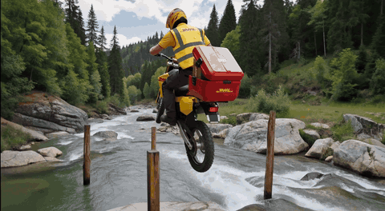

*The bullet-time jump from "Urgent delivery", a 16-part, 2:35 story made with the [story kit](#make-your-own-story-video) (6.5 s, scaled down to 480 px for the README; the original is 1920×1056 at 48 fps).*

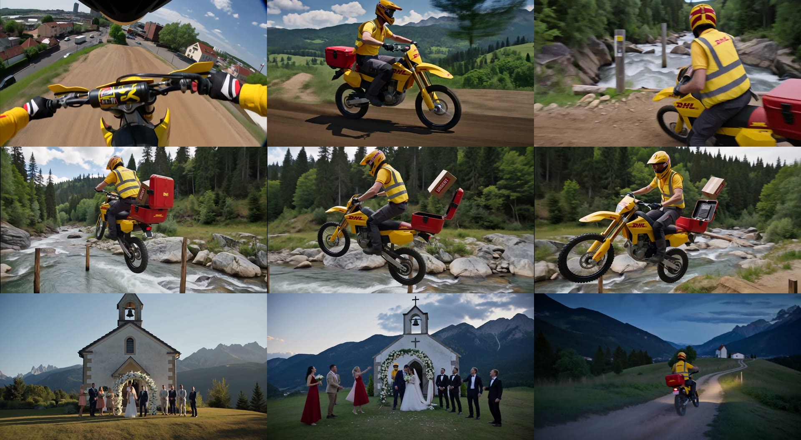

*More frames: a first-person ride over the dike, the ridge, the creek without a bridge, the jump, and the chapel.*

---

## Contents

1. [Example: a 10-part story](#example-a-10-part-story)
2. [What it does](#what-it-does)
3. [How it works](#how-it-works)
4. [Installation](#installation)
5. [Workflow 1 – PlagueKind Long Video (generate)](#workflow-1--plaguekind-long-video-generate)
6. [Workflow 2 – Upscale](#workflow-2--plaguekind-long-video--upscale)
7. [Workflow 3 – Face Detail](#workflow-3--plaguekind-long-video--face-detail)
8. [Make your own story video](#make-your-own-story-video)
9. [Node reference](#node-reference)
10. [Project folder layout](#project-folder-layout)
11. [Settings that matter (and why)](#settings-that-matter-and-why)
12. [Prompting tips](#prompting-tips)
13. [Timings](#timings-rtx-3090)
14. [Troubleshooting](#troubleshooting)
15. [Known limitations](#known-limitations)
16. [Technical notes](#technical-notes)
17. [Claude Code skill](#claude-code-skill)

---

## Example: a 10-part story

The pipeline was developed on this story: **a DHL courier picks up a package at home, drives through a Dutch city and delivers it at a blue front door.** It is 95 seconds long, made of 10 parts with 6 locations, and the same person and uniform appear throughout.

### Inputs

| Ref | Image | Used as |
|---|---|---|
| Ref 1 | frontal face photo of the courier in a DHL cap | `Picture 1` (identity) |
| Ref 2 | 4-view character sheet: DHL cap, polo, hi-vis vest, work trousers | `Picture 2` (outfit) |
| Ref 3 | Street View-style photo of the location of that part | `Picture 3` (location) |

Settings for every part:
- Project `dhl_delivery`
- 1280×720 (today you'd use 1280×704, see [sizes](#sizes-must-be-multiples-of-32))
- 10 s per part, Turbo on, SLA off

### Shot list

The story is planned as **shots** (one location, one camera position) made of one or more **parts**. Each shot starts with a part that has **New shot** on; the following parts in that shot continue it seamlessly.

| Part | Location (Ref 3) | Join | What happens |
|---|---|---|---|
| 1 | Front door of the house (`huis.png`) | **new shot** | Comes out of the front door with a package, walks toward the camera; the DHL van is parked at the curb |
| 2 | same | continue | Loads the package, climbs into the van, engine starts |
| 3 | Narrow street (`huis_straat.png`) | **new shot** | Front of the van drives toward the camera and passes it |
| 4 | City canal (`huis_straat2.png`) | **new shot** | Van drives past along the canal, right to left |
| 5 | Tram crossing (`huis_straat3.png`) | **new shot** | Van crosses the crossing over the tram tracks |
| 6 | Street corner (`huis_straat4.png`) | **new shot** | Van enters from the bottom of the frame and turns right into the street |
| 7 | same | continue | Van parks, courier gets out with the package |
| 8 | Blue front doors (`huis2.png`) | **new shot** | Walks to the first blue door and rings the bell |
| 9 | same | continue | Door opens, handover with dialogue |
| 10 | same | continue | "Have a nice day!", walks off empty-handed, door closes |

So the video has six shots: the house (parts 1–2), the street (3), the canal (4), the crossing (5), the corner (6–7) and the front door (8–10).

### How it was made

1. **Generate (workflow 1).** One queue run per part in the order above. For each part, set Part number, New shot, Ref 3 and the scene prompt. It took ~12 min per part with turbo, ~2 h in total.
2. **Review and re-roll.**
   - Part 4's van was tiny and hidden behind trees: re-rolled with the camera on the pavement next to the road.
   - Part 10 cut to an odd shot through a window: re-rolled twice. The final version stays in part 9's doorway framing, so the courier walks off with empty hands instead of reappearing with the delivered box.
   - Because part 5 starts a new shot, re-rolling part 4 kept parts 5–10.
3. **Upscale (workflow 2).** Parts 1→10 in order, 1920×1056 at 48 fps, ~14 min per part. The continuation joins (into parts 2, 7, 9 and 10) are crossfaded.
4. **Face detail (workflow 3).** Parts 1→10 with Ref 1 as the face reference.
   - Changed: parts 1, 2, 3, 4, 7, 8 and 10, where the courier's face was 30–140 px.
   - Skipped: parts 5, 6 and 9, where there was no small matching face. The woman at the door was never touched; her face scored ≤ 0.13 against the reference.

### Result

- **Video:** 94.7 s, 1920×1056, 48 fps.
- **Joins:** seamless joins within shots and clean hard cuts between them.
- **Dialogue:** all three lines were transcribed correctly by Whisper.
- **Sync:** audio in sync to the end (94.72 s audio vs 94.75 s video).

### The prompts

Every prompt repeats the same character description, every continuation starts with *"Continue the same shot without a cut"*, and every shot has a static camera.

<details>
<summary>All 10 prompts (click to expand)</summary>

**Part 1** (New shot on; Ref 3 = huis.png)

```text
Static locked-off camera, wide shot of the street from Picture 3: red brick apartment building with dark balconies, white front doors and a green container. Sam from Picture 1 and Picture 2, a man in his early thirties with short dark brown curly hair and light stubble, wearing the DHL uniform from Picture 2: red and yellow DHL cap, yellow DHL polo shirt, yellow hi-vis vest and dark grey work trousers comes out of the white front door carrying a brown cardboard package, pulls the door shut behind him and walks along the pavement toward the camera. A yellow DHL delivery van with the red DHL logo is parked at the curb in the foreground. Quiet street ambience, footsteps.
```

**Part 2** (New shot off; Ref 3 = same as before)

```text
Continue the same shot without a cut. One continuous take, static locked-off camera. Sam from Picture 1 and Picture 2, a man in his early thirties with short dark brown curly hair and light stubble, wearing the DHL uniform from Picture 2: red and yellow DHL cap, yellow DHL polo shirt, yellow hi-vis vest and dark grey work trousers walks to the yellow DHL delivery van parked at the curb, opens the driver's door, puts the brown package on the passenger seat, climbs in behind the wheel and closes the door. The engine starts. Quiet street ambience, van door closing, engine starting.
```

**Part 3** (New shot on; Ref 3 = huis_straat.png)

```text
Static locked-off camera standing low in the middle of the narrow brick street from Picture 3, with parked cars on both sides, trees and apartment buildings. A yellow DHL delivery van with the red DHL logo drives toward the camera down the street, the front of the van and the windscreen clearly visible, Sam from Picture 1 and Picture 2, a man in his early thirties with short dark brown curly hair and light stubble, wearing the DHL uniform from Picture 2: red and yellow DHL cap, yellow DHL polo shirt, yellow hi-vis vest and dark grey work trousers at the wheel. The van comes closer and passes the camera on the left. Engine sound, quiet street ambience.
```

**Part 4** (New shot on; Ref 3 = huis_straat2.png)

```text
Static locked-off camera on the pavement of the road that runs along the city canal from Picture 3; behind the road are the tall trees, the green grass bank and the water of the canal. A yellow DHL delivery van with the big red DHL logo on its side drives past the camera from right to left, close to the camera, large and clearly visible in the frame, Sam from Picture 1 and Picture 2, a man in his early thirties with short dark brown curly hair and light stubble, wearing the DHL uniform from Picture 2: red and yellow DHL cap, yellow DHL polo shirt, yellow hi-vis vest and dark grey work trousers visible at the wheel through the side window. The van drives on and leaves the frame on the left. Engine sound passing by, birds, distant traffic.
```

**Part 5** (New shot on; Ref 3 = huis_straat3.png)

```text
Static locked-off camera at the crossing from Picture 3: a road with tram tracks in the grass median, a cycle path, overhead tram wires and brick corner buildings. A yellow DHL delivery van with the red DHL logo comes along the road toward the crossing, slows down and drives straight across the crossing over the tram tracks. City traffic ambience.
```

**Part 6** (New shot on; Ref 3 = huis_straat4.png)

```text
Static locked-off camera at the street corner from Picture 3: a tall brick corner building, a big bare tree, parked cars and a cargo bike. A yellow DHL delivery van with the red DHL logo enters from the bottom of the frame and turns right into the street, driving past the parked cars. Engine sound, quiet street ambience.
```

**Part 7** (New shot off; Ref 3 = same as before)

```text
Continue the same shot without a cut. One continuous take, static locked-off camera. The yellow DHL delivery van slows down and parks along the curb. The driver's door opens and Sam from Picture 1 and Picture 2, a man in his early thirties with short dark brown curly hair and light stubble, wearing the DHL uniform from Picture 2: red and yellow DHL cap, yellow DHL polo shirt, yellow hi-vis vest and dark grey work trousers gets out holding the brown cardboard package, closes the door and walks along the pavement. Quiet street ambience, van door closing.
```

**Part 8** (New shot on; Ref 3 = huis2.png)

```text
Static locked-off camera across the street facing the brick house from Picture 3, with white window frames and two dark blue front doors. Sam from Picture 1 and Picture 2, a man in his early thirties with short dark brown curly hair and light stubble, wearing the DHL uniform from Picture 2: red and yellow DHL cap, yellow DHL polo shirt, yellow hi-vis vest and dark grey work trousers walks in from the left along the pavement carrying a brown cardboard package, stops at the first dark blue door, the left one, and rings the doorbell. Quiet street ambience, footsteps, a doorbell.
```

**Part 9** (New shot off; Ref 3 = same as before)

```text
Continue the same shot without a cut. One continuous take, static locked-off camera. The first dark blue door opens and a woman in her thirties with dark hair stands in the doorway. Sam from Picture 1 and Picture 2, a man in his early thirties with short dark brown curly hair and light stubble, wearing the DHL uniform from Picture 2: red and yellow DHL cap, yellow DHL polo shirt, yellow hi-vis vest and dark grey work trousers smiles and says, his lips moving clearly: "Good afternoon! A package for you." He hands her the package. The woman takes it and says: "Oh great, thank you!" Quiet street ambience.
```

**Part 10** (New shot off; Ref 3 = same as before)

```text
Continue the same shot without a cut. One continuous take, the camera stays exactly where it is, just inside the open front door looking out at the street, and never changes angle. The woman with dark hair stands in the foreground holding the brown cardboard package in both arms. Sam from Picture 1 and Picture 2, a man in his early thirties with short dark brown curly hair and light stubble, wearing the DHL uniform from Picture 2: red and yellow DHL cap, yellow DHL polo shirt, yellow hi-vis vest and dark grey work trousers, standing outside on the pavement with empty hands, smiles, gives a small wave and says: "Have a nice day!" He turns and walks away along the pavement to the left and out of view, his hands empty. The woman steps back holding the package and slowly closes the dark blue door. Quiet street ambience, footsteps, a door closing.
```

</details>

---

## What it does

MiniMax H3 generates roughly 10–15 seconds of video with sound per pass. Longer videos usually mean rendering separate clips and joining them, which gives visible jumps: the pose, lighting and character change at every cut. Crossfading overlapping clips doesn't fix it either; you get a visible fade and a pose jump.

This pack lets every new part **continue from the actual end of the previous part, inside the model's latent space**:

- The last 39 frames (1.6 s) of part *N−1*, picture **and** sound, are copied into the start of part *N* and frozen. H3 only generates what comes after. Motion, pose, framing, lighting and voice continue straight through the join.
- Each part is saved to disk (its latent, its new frames and its conditioning). A video can therefore grow without limit: one queue run per part, and RAM use stays the same however long the video gets.
- A part can also be a **new shot**: a deliberate hard cut to a new location, still appended to the same video.
- Any part can be **re-rolled**. Later parts that depend on it are set aside automatically. Later parts that started a new shot are kept.
- When all parts are approved, a **separate upscale workflow** re-samples each part with H3's own latent upscaler: 1.5× to 1920×1056, FILM interpolation to 48 fps, RCAS sharpening. At the seamless joins it crossfades over the shared 1.6 s, so detail doesn't jump.
- A **face-detail workflow** then finds the main character by face recognition, re-renders their face as a close-up wherever it is small in the frame, and pastes it back. Nobody else is changed.

---

## How it works

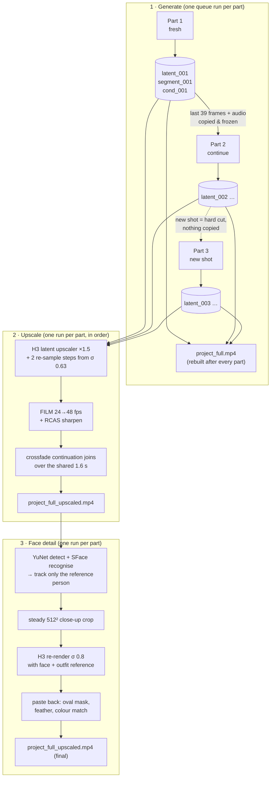

### Continuing in latent space

H3's video latent packs 24 fps frames into temporal steps: the first 5 frames are 2 latent steps, and every further 17 frames are 5 more steps. A run of 39 frames is therefore exactly 12 latent steps, and the audio latent runs at 40 Hz, so the same 39 frames are 65 audio steps.

For a continuation, `Long Video: Continue From Previous Part` loads the previous part's saved latent and hands it to `MiniMaxH3GeneratedAVMaskedContext` (from the Motion-Context pack):

- It copies the previous part's last 12 video steps and 65 audio steps into the first steps of the new, empty latent.
- It sets a noise mask of 0 on those steps (frozen) and 1 everywhere else. The last 8 audio ticks (0.2 s) get a soft cosine release, so the sound blends in.
- The sampler only denoises the unfrozen part.

The frozen frames were never decoded and re-encoded, so they are exactly the previous part's frames: in testing, the copied latent matched the source to 2·10⁻⁷. After decoding, `Long Video: Append Part` cuts those 39 frames off again (picture and sound by exactly the same duration) and stores only the new frames.

### The stored latents

Every generated part leaves two files in `output/long_video/<project>/latents/`, next to its decoded video in `segments/`:

| File | What it is | Size (10 s, 1280×704) |
|---|---|---|
| `part_NNN.safetensors` | the sampler output: the part's complete video **and** audio latent, before decoding | ~24 MB |
| `part_NNN.cond.pt` | the conditioning the part was made with: the prompt embedding plus the encoded reference images | ~15–22 MB |

They are what makes the rest of the pipeline work:

- **Continuing.** The next part copies the last 39 frames (12 video steps, 65 audio steps) straight out of `part_N-1.safetensors`. Nothing is decoded and re-encoded, so the join is exact. Without the previous part's latent a continuation can't run (only **New shot** can).
- **Upscaling.** The upscale workflow doesn't upscale the mp4. It loads the part's latent, upscales it with H3's latent upscaler and re-samples it with the saved conditioning. It never runs the 26 GB text encoder or re-encodes the reference images, so it uses much less memory than generating, and it re-samples exactly what was generated.
- **Re-rolling.** Generating part N again overwrites its latent. Parts that continued from the old part N no longer fit, so their latents, segments and conditioning are moved to `_superseded/` (up to the next new shot), and must be generated again.
- **Inspecting.** `Long Video: Load Part Latent` turns a saved latent back into a normal H3 latent you can decode or feed into other nodes. The format is the Motion-Context pack's, so its own `H3 Motion Context Load Latent` node reads it too.

**Keep them** until the upscale (and the face pass) of all parts is finished. After that you can delete `latents/` to save space; the finished videos don't need them. You then can't re-upscale a part or continue the story; to keep the option of adding parts later, keep at least the last part's `.safetensors`.

Disk use of the 16-part, 2:35 example: `latents/` 610 MB (373 MB latents + 237 MB conditioning), `segments/` 254 MB, `upscaled/` 784 MB.

### Keeping picture and sound in sync over many parts

H3's audio grid (40 Hz) and the video frame rate (24 fps) don't line up for every length, so a decoded part's audio can be a few milliseconds longer or shorter than its picture. Over ten parts that would add up. The append node conforms each part's audio to exactly *frames ÷ 24* seconds before storing it, and the parts are stored with lossless FLAC audio, so the joins never drift. Measured over the 95-second, 10-part test: 0.01 ms drift per part.

### The upscale

The upscale is the same "Tiled Latent Upscaler" stage as in the PlagueKind V11 workflow, run separately on each part's saved latent:

1. The `minimax_h3_latent_upscaler_3d` model scales the latent up by 1.5×.
2. `MMH3UltimateUpscale` re-samples it with the H3 model in overlapping 102-frame time chunks, using 2 steps (σ 0.6316 → 0.3158 → 0) and the part's original conditioning.
3. The result is decoded, interpolated to 48 fps with FILM and sharpened with RCAS at 0.3.

Starting at σ 0.63 lets H3 redraw fine detail, such as individual bricks and the spokes of bikes, while objects, composition and motion stay those of the original. A plain resize only softens and sharpens what is already there.

V11 starts at σ 0.9035. That is close to a full re-generation: H3 redraws small props from the prompt instead of following the original. In a test, a brown parcel with a red sticker got a bright pink "URGENT" label and then turned into a see-through white box halfway through the part, while the original stayed brown. At 0.6316 the parcel stayed as in the original; at 0.45 it was softer and the label drifted more.

**Continuation joins.** Part *N* starts with the same 1.6 s that part *N−1* ends with. Upscaled separately, those 1.6 s come out with slightly different fine detail, for example a van logo or a bike rack. Instead of switching at the cut, the append node blends the end of part *N−1* into the start of part *N* over the full 78 shared frames at 48 fps, so differences fade instead of jumping. It blends with a copy of *N−1*'s tail made before any blending (`part_NNN.tail.mkv`), so re-running a part never blends twice.

### The face pass

In a wide shot the face is only a few latent cells big. At 1280×720 a face of 60 px is about 4×4 cells, so neither generation nor upscaling can hold a likeness, and faces drift. The face pass:

1. **Finds the right person.** YuNet detects every face. SFace compares each frontal face of at least 40 px with the reference photo, and only frames where a face scores at least `match` on its own count. Short gaps between confirmed frames are bridged; nothing is followed beyond that (see *Face pass in crowds* below).
   - In testing, the reference person scored 0.35–0.59 and the other person in the scene −0.01 to 0.13.
   - In one shot the other person's face was the *only* one detected. A "largest face" rule would have given her his face, which is why identity matching is used.
2. **Cuts a steady close-up.** It smooths the face track (position over 9 frames, size over 25), cuts a square of 2.6× the face size and scales it to 512×512.
3. **Re-renders it with H3.** It runs a partial denoise from σ 0.8, using the face photo and outfit sheet as references and a "close-up of the face of the man from Picture 1 and Picture 2" prompt. Because it works in time chunks, the face is consistent over time and keeps its motion and expression.
4. **Pastes it back.** It uses an oval mask (0.75× face size, feather 0.35), matches the colour to the surroundings, and fades in and out around frames where the face is missing or outside the 30–140 px range.

The clean upscale is kept (`part_NNN.noface.mkv`), and re-running a part always starts from it.

---

## Installation

### 1. Required custom node packs

| Pack | Used for |
|---|---|
| this pack (`h3_output_video`) | long-video, upscale and face nodes |
| [ComfyUI-PlagueKind-Nodes](https://github.com/PlagueKind/Comfyui-PlagueKind-Nodes) | `PK_MiniMaxH3Combined`, `MMH3UltimateUpscale` + params, `H3AdaLNLoRAFix`, `H3SLAAttention`, `MiniMaxLowVRAMAttention`, `MiniMaxChunkFeedForward` |
| [ComfyUI-H3-Motion-Context-MultiRef](https://github.com/seitanism/ComfyUI-H3-Motion-Context-MultiRef) | `MiniMaxH3GeneratedAVMaskedContext`, `MiniMaxH3MotionContextTrim` (called internally), `MiniMaxH3SongMaskedAVContext` (dialogue parts) |
| [TTS Audio Suite](https://github.com/diodiogod/TTS-Audio-Suite) (optional) | ChatterBox text-to-speech for [dialogue with your own voices](#dialogue-with-your-own-voices) |
| [ComfyUI-KJNodes](https://github.com/kijai/ComfyUI-KJNodes) | `ModelPreviewOverrideKJ`, `ImageSharpenKJ` |
| ComfyUI core (recent, with MiniMax H3 + FILM support) | `FrameInterpolate`, `ComfySwitchNode`, `ComfyMathExpression`, `LTXVConcatAVLatent` / `LTXVSeparateAVLatent` (generic AV latent packing in the face workflow; no LTX model is used) |

```bash
cd ComfyUI/custom_nodes
git clone https://github.com/fuzzballb/comfyui-h3-long-video h3_output_video
```

`ffmpeg` and `ffprobe` must be on `PATH`. Python dependencies (`opencv-python`, `numpy`, `safetensors`) are already part of a normal ComfyUI install.

### 2. Models

| File | Folder | Used by |
|---|---|---|
| `minimax_h3_hybrid_fl2va_ref2va_b25-49-int8.safetensors` | `diffusion_models` | generation, upscale, face pass |
| `qwen3vl_32b_minimax_h3_int8_convrot.safetensors` | `text_encoders` | conditioning (use the int8 variant on RTX 30xx; NVFP4 needs newer GPUs) |
| `minimax_h3_video_vae_int8_convrot.safetensors` | `vae` | |
| `minimax_h3_audio_vae_fp32.safetensors` | `vae` | |
| `minimax_h3_fl2v_turbo_8step_v1.0_comfyui_bf16.safetensors` | `loras` | optional **Turbo** switch (8 steps) |
| `minimax_h3_latent_upscaler_3d_bf16.safetensors` | `latent_upscale_models` | upscale |
| `film_net_fp16.safetensors` | `frame_interpolation` | 48 fps |
| `taeh3.safetensors` | `vae_approx` | live sampler previews (`ModelPreviewOverrideKJ`) |
| `face_detection_yunet_2023mar.onnx` | `detection` | face pass ([OpenCV Zoo](https://github.com/opencv/opencv_zoo/tree/main/models/face_detection_yunet)) |
| `face_recognition_sface_2021dec.onnx` | `detection` | face pass ([OpenCV Zoo](https://github.com/opencv/opencv_zoo/tree/main/models/face_recognition_sface)) |

### 3. Restart ComfyUI

New nodes only load on a restart. The workflows then show up under the pack's templates, or you can drag the JSON files from `example_workflows/` onto the canvas.

---

## Workflow 1 – PlagueKind Long Video (generate)

`example_workflows/1 - PlagueKind Long Video.json`

It's the PlagueKind V11 model stack (hybrid H3 model, low-VRAM attention, chunked feed-forward, AdaLN-LoRA fix, `PK_MiniMaxH3Combined` conditioning) with the long-video nodes wrapped around the sampler.

<p>
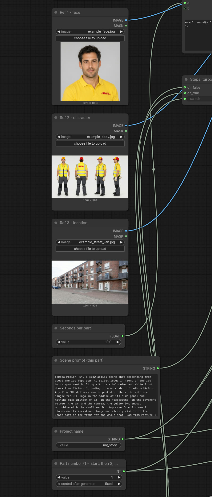
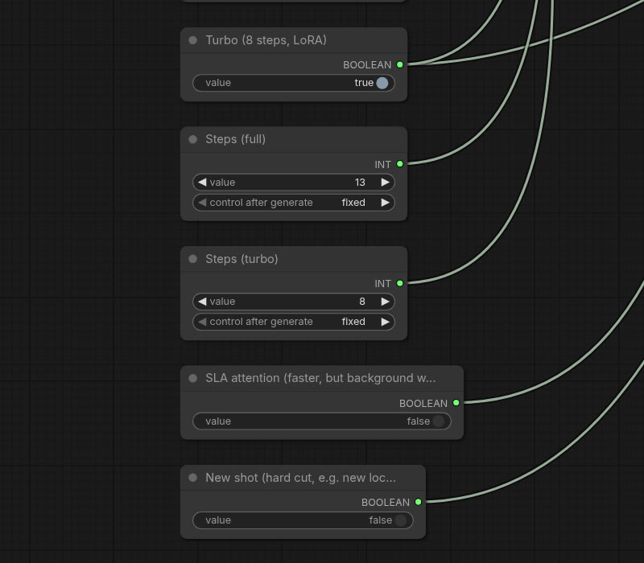
</p>

*Left: the inputs you change per part (face, outfit sheet, location, scene prompt, project, part number). Right: the switches (Turbo, steps, SLA attention, New shot).*

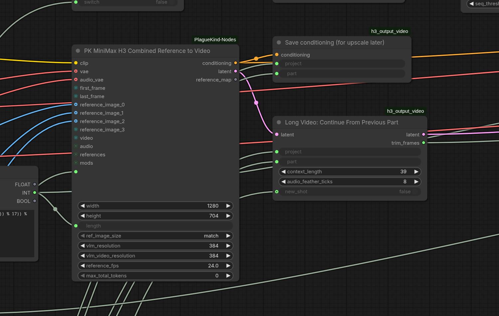

*`PK_MiniMaxH3Combined` builds the conditioning from the prompt and the reference images, and an empty latent for this part. **Continue From Previous Part** loads the previous part's stored latent (`latents/part_N-1.safetensors`) and copies its last 39 frames (12 video steps plus the matching audio) into the start of this part's latent, frozen, so the sampler only generates what comes after. **Save conditioning** writes this part's conditioning to `latents/part_NNN.cond.pt` for the upscale. See [The stored latents](#the-stored-latents).*

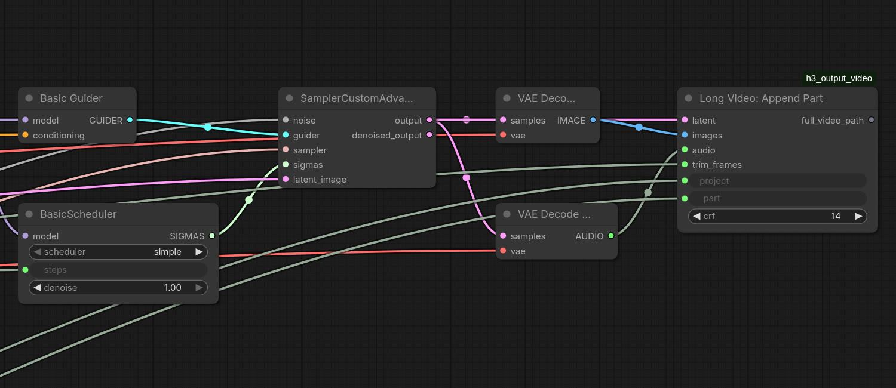

*After sampling, **Append Part** stores this part's latent as `latents/part_NNN.safetensors` (the next part continues from it, the upscale re-samples it), cuts the 39 shared frames off the decoded video, saves the new frames to `segments/` and rebuilds `<project>_full.mp4`.*

### Inputs you change

| Widget | Meaning |
|---|---|
| **Project name** | Folder under `output/long_video/`. Use one name for the whole video. |
| **Part number** | 1 = first part. Then 2, 3, … Run the same number again to re-roll that part. |
| **New shot** | Off = continue the previous part seamlessly. On = start this part fresh (hard cut, e.g. a new location); it is still appended. |
| **Scene prompt** | What happens in this part. See [prompting tips](#prompting-tips). |
| **Ref 1 / Ref 2 / Ref 3** | `<Picture 1>`, `<Picture 2>`, `<Picture 3>` in the prompt: usually face, outfit and location. Swap Ref 3 for a new location together with **New shot**. |
| **Seconds per part** | Length of one generation (10 s default). A continuation adds *seconds − 1.6 s* of new video. |
| **Turbo** | Off = 13 steps (best). On = turbo LoRA at 0.95 + sigma shift 12/3, 8 steps (~35 % faster). It can change between parts. |
| **SLA attention** | Off (default) = stable background. On = ~2.8× faster per step, but straight lines (windows, balconies) wobble. See [why](#sla-attention-makes-backgrounds-warp). |
| **Width / height** | Must be multiples of 32: 1152×864, 1280×704 (not 720!). Keep them the same for the whole project. |

### Typical session

1. Part 1: Project `my_video`, Part number 1, New shot off, scene prompt, queue.
2. Like it? Part number 2, write the next scene starting with *"Continue the same shot without a cut:"*, queue.
3. Don't like part 2? Queue part 2 again (new seed). Part 3 and later, if they exist and continue from 2, are moved to `_superseded/`.
4. New location: Part number N, **New shot on**, Ref 3 = the new location photo, queue.
5. `output/long_video/my_video/my_video_full.mp4` is rebuilt after every part.

---

## Workflow 2 – PlagueKind Long Video – Upscale

`example_workflows/2 - PlagueKind Long Video - Upscale.json`

Run this **after** all parts are approved, once per part, **in order** (1, 2, 3, …). In order matters because each continuation crossfades into the already-upscaled part before it. Queue with the Part number widget set to *increment* and a batch count equal to the number of parts.

<p>
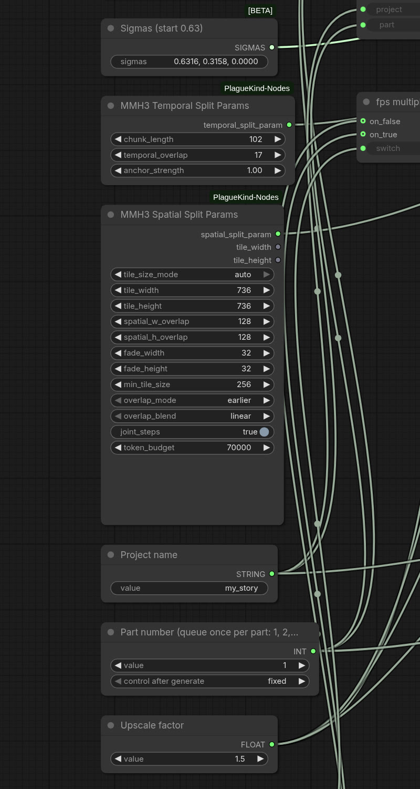
</p>

*Settings: the re-sample sigmas (start 0.63), the temporal and spatial split, project, part number and upscale factor.*

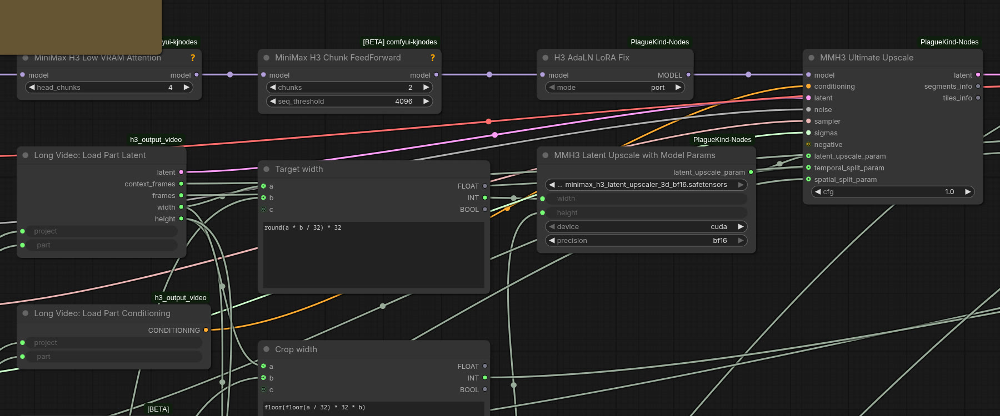

*The part's saved latent and conditioning are loaded, upscaled 1.5× by the H3 latent upscaler and re-sampled with H3 in tiles and time chunks.*

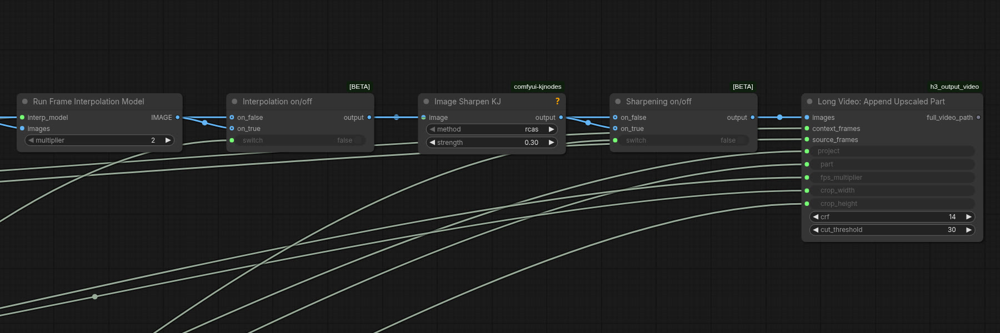

*FILM ×2 (48 fps), RCAS sharpening, then **Append Upscaled Part** crossfades the join with the previous part and fixes interpolation across hard cuts.*

| Widget | Default | Meaning |
|---|---|---|
| Project name | – | same as in workflow 1 |
| Part number | 1 | |
| Upscale factor | 1.5 | 1280×720 → 1920×1088, cropped to 1920×1056 (the padding strip of the non-/32 source height) |
| Sigmas | `0.6316, 0.3158, 0.0000` | V11's schedule without its first step (`0.9035, …` redraws small props, see above) |
| Frame interpolation | on | FILM ×2 → 48 fps |
| FSR sharpening | on | RCAS 0.3 |
| Temporal split | 102 frames, 17 overlap, anchor 0.999 | V11 values |

The crop is computed from the part size (`floor(floor(h/32)·32 · factor)`), so it stays correct if you change the factor.

Output: `output/long_video/<project>/<project>_full_upscaled.mp4`, with the original audio, rebuilt after every part.

---

## Workflow 3 – PlagueKind Long Video – Face Detail

`example_workflows/3 - PlagueKind Long Video - Face Detail.json`

Run this **after the upscale has finished all parts**, once per part. Parts without a small matching face are skipped in seconds.

<p>
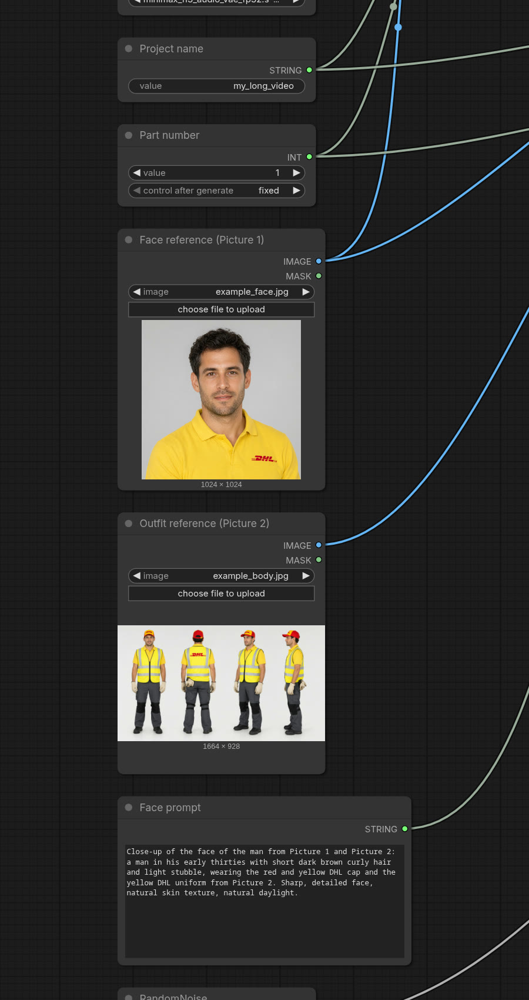
</p>

*Inputs: project, part, the same face and outfit references as the generation, and a face prompt describing the person.*

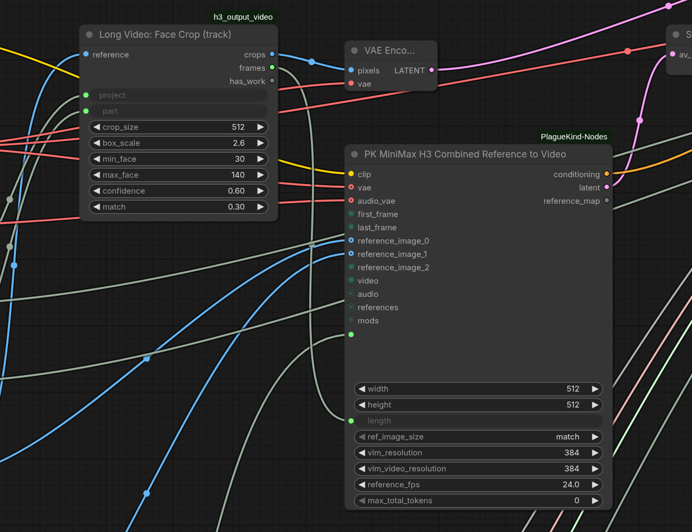

*Face Crop (track) finds the reference person's small faces and cuts a 512² close-up that follows them; H3 re-renders it at low strength.*

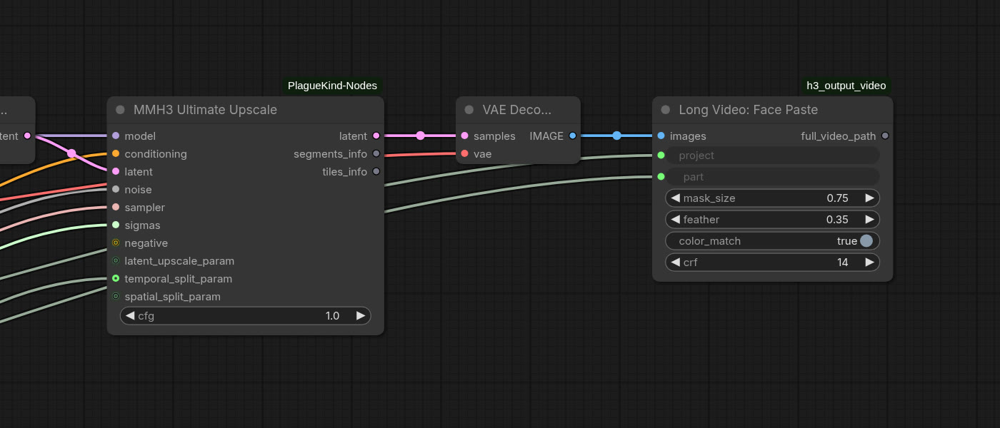

*Face Paste blends the re-rendered close-up back into the upscaled part with an oval mask.*

| Widget | Default | Meaning |
|---|---|---|
| Face reference (Picture 1) | – | a clear frontal photo of the person to fix |
| Outfit reference (Picture 2) | – | e.g. a character sheet with the clothes/cap |
| Face prompt | "Close-up of the face of the man from Picture 1 and Picture 2: …" | describe the person: glasses, beard, cap… |
| Face re-render strength | `0.8, 0.6, 0.4, 0.2, 0.0` | 0.8 = clearly closer to the reference; 0.6 = sharper but keeps the wrong face (tested) |
| min_face / max_face | 30 / 140 px | only faces in this size range are changed |
| match | 0.3 | face-recognition similarity needed (node default 0.35); other people score ~0–0.15 |
| box_scale | 2.6 | crop square = face size × this |
| crop_size | 512 | resolution of the close-up H3 renders |

---

## Make your own story video

This is the full recipe behind the 16-part "urgent delivery" video (2:35): a courier picks up a parcel, races through the city and over a creek on an enduro bike, and delivers the wedding rings to a chapel just in time. Everything except the personal reference photos is in this repo.

### What you need

1. **The install above**: node packs, models, and this node pack.
2. **Extra LoRAs** in `models/loras` (all from Civitai; rename where shown):

| LoRA | File | Trigger | Used for |
|---|---|---|---|
| [Camera Motion H3](https://civitai.com/models/2914784/cameramotionh3?modelVersionId=3297480) | `camera_motion_h3_lora_v1_3000_pruned.safetensors` | start the prompt with `camera motion,` | cranes, orbits, tracking shots |
| [Authentic Cinematic Texture](https://civitai.com/models/2890588/minimax-h3-authentic-cinematic-texture?modelVersionId=3267949) | rename to `mmh3_cinematic_texture_DY.safetensors` | `DY` | film look |
| [Better Human Motion](https://civitai.com/models/2734359/better-human-motion-minimax-h3?modelVersionId=3256084) | `mvmt_h3_lora_v1_500.safetensors` | – | walking, handling objects |
| [Extreme Enduro](https://civitai.com/models/2989996/extreme-enduro-better-bike-povs-and-motion?modelVersionId=3390388) | `extremeEnduroBetterBike_v1.safetensors` | – | bike POVs and riding |
| [Bullet Time](https://civitai.com/models/2934116/mmh3-bullet-time?modelVersionId=3321093) | `BulletTime-MMH3.safetensors` | `bullet-time` + timestamped phases | the jump |
| [VFX-Edit](https://civitai.com/models/2954203/vfx-edit?modelVersionId=3346199) (optional, not used in the example) | `minimax_h3_vfx_edit_v1.0_r128_ffp.safetensors` | `vfx_edit:` | video-to-video effects on a finished part (needs the source clip as a guide) |

   Keep the sum of extra LoRA strengths around 1.2–1.3 on the turbo (see [ghosting](#stacking-extra-loras-on-the-turbo-makes-moving-objects-ghost)); the example story sets them per part.
3. **For prop sheets** (optional): Qwen Image 2.1 from [Comfy-Org/Qwen-Image-2.1](https://huggingface.co/Comfy-Org/Qwen-Image-2.1): `diffusion_models/qwen_image_2.1_int8_convrot.safetensors`, `vae/qwen_image_2.1_vae_bf16.safetensors`, and `text_encoders/qwen3vl_8b_int8_convrot.safetensors`.
4. **Reference images** in `ComfyUI/input`. [`story_kit/refs/`](story_kit/refs) has a complete generated set, so the example story runs as is: copy the folder's files into `ComfyUI/input`. All of them were made with Qwen Image 2.1 (workflow 4 / `propsheet.py`); the courier "Sam" and the streets are fictional.

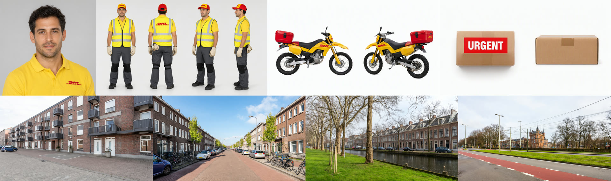

| File | Picture | What it is |
|---|---|---|
| `example_face.jpg` | 1 | face of the main character |
| `example_body.jpg` | 2 | outfit sheet: front, back, three-quarter, side |
| `example_street_van.jpg`, `example_street_brick.jpg`, `example_canal.jpg`, `example_tram_crossing.jpg` | 3 | locations of parts 1–3, 4, 5 and 6 |
| `example_bike.png`, `example_parcel.png` | 3–5 | prop sheets, added only to parts that mention the prop |

   For your own video, replace them: a tight face crop and an outfit sheet of your character, photos of your locations, and prop sheets made from crops of a first test render.

### Steps

1. **Write the story** as a Python file, starting from [`story_kit/stories/dhl_enduro.py`](story_kit/stories/dhl_enduro.py). Each part is `(new_shot, location image or None, [(lora, strength)], prompt)`, 10 s each. Put the character description in a variable and use it in every prompt. Write a prop as a token (`<BIKEREF>`); the runner adds that prop sheet only to the parts that mention it and fills in the right `Picture n`. Follow the [prompting tips](#prompting-tips): every part either continues the previous shot without a cut or is a new shot, one or two actions per part.
2. **Make prop sheets** (optional) with workflow 4 (`example_workflows/4 - Prop Sheet (Qwen Image 2.1).json`; put the crops in `input/` as `prop_source_1.png` and `prop_source_2.png`) or `story_kit/propsheet.py`, feeding crops of the prop from a first test render. Pick a sheet where the prop is identical in both views and copy it into `input/`.

   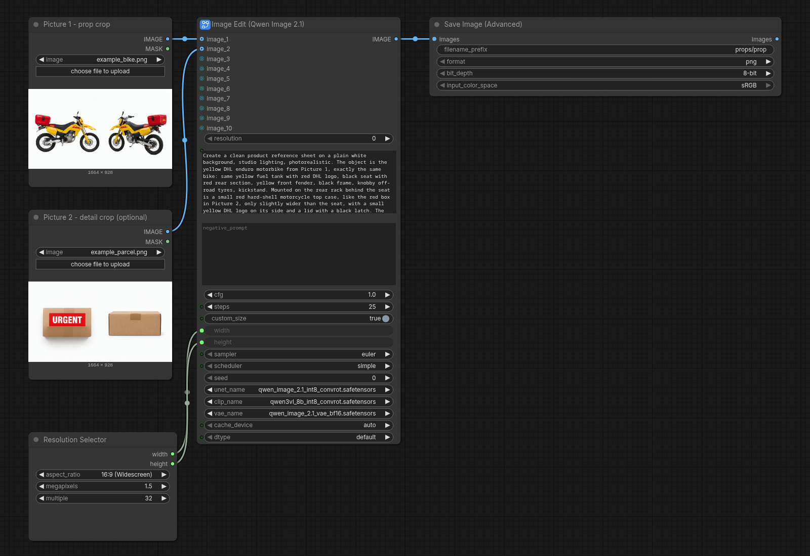

   *Workflow 4: one or two crops of the prop go in as Picture 1 and 2, the prompt asks for two views on a white background.*

3. **Check the prompts**: `python3 story_kit/run_story.py prompts my_story.py`.
4. **Generate**: `python3 story_kit/run_story.py gen my_story.py my_project`. Each part takes ~10 min (1280×704, 10 s, turbo). Output: `output/long_video/my_project/`.
5. **Check every part as it finishes**: `python3 story_kit/check_cuts.py output/long_video/my_project 5` prints hard cuts and writes a contact sheet `segments/part_005_sheet.png`. Look at the sheet for continuity (props, objects appearing from nowhere, doubled logos).
6. **Re-roll a bad part** with a new seed or a better prompt: `FRONT=1 python3 story_kit/run_story.py gen my_story.py my_project 5`. This moves the parts that continue from it to `_superseded/` (up to the next new shot); queue those again too. In the 16-part run, 6 of 16 parts needed a re-roll; the causes are in the prompting tips.
7. **Upscale** once all parts are final (it works from the [stored latents](#the-stored-latents), so keep `latents/` until it's done): `python3 story_kit/run_story.py upscale my_project 1 16` (~10 min per part). Before that, free the RAM the generation models still hold: `curl -X POST 127.0.0.1:8188/free -d '{"unload_models":true,"free_memory":true}'`. Result: `my_project_full_upscaled.mp4`.
8. **Face pass** (optional, workflow 3) for small faces of the main character in wide shots.

### Dialogue with your own voices

Left to itself, H3 makes up the speech together with the picture. With a quoted line in the prompt it usually gets the words right, but often enough it mumbles or turns them into gibberish, and it picks its own voice. The story kit can instead **make the dialogue first and freeze it**:

1. In the story file, give each speaker a voice and a part a list of lines, and put `{DIALOGUE}` in its prompt (see [`story_kit/stories/doorstep_dialogue.py`](story_kit/stories/doorstep_dialogue.py)):

   ```python
   VOICES = {'Sam': ('my_voice.wav', 'his'), 'Lisa': ('voices_examples/female/female_01.wav', 'her')}
   PARTS = {1: (True, None, [], "One continuous take, a static medium two-shot ... {DIALOGUE} ...",
                [('Sam', 'Good afternoon! Urgent delivery for you.'), ('Lisa', 'Oh, finally!')])}
   ```

   A voice is a file name from the [TTS Audio Suite](https://github.com/diodiogod/TTS-Audio-Suite) voice list: your own recording (10–20 s of clean speech) in `ComfyUI/models/voices/`, or one of its example voices.
2. `python3 story_kit/run_story.py dialogue my_story.py my_project 1` speaks every line with ChatterBox in its speaker's voice, joins them with short pauses into one track per part, and uploads it with the timings.
3. `run_story.py gen` replaces `{DIALOGUE}` with the timed lines (`0.5-4.2s: Sam says, his lips moving clearly: "…"`) and freezes the track in the part's audio latent with `MiniMaxH3SongMaskedAVContext` (from the Motion-Context pack). H3 then only animates the faces to it: the words can't change.

For a continuation part, run `dialogue` after the previous part is generated: its track starts with the previous part's last 39 frames of audio, so the join stays exact.

Test (`doorstep_dialogue.py`, 2 parts, 5 lines, the second part a continuation; voice 1 = a user recording, voice 2 = a TTS example voice): Whisper heard exactly the written lines in both parts, the audio matched the TTS track (correlation 0.98), the lips moved only for the person speaking, and neither part had a cut.

Limits: the part's whole sound is the dialogue track, so H3 adds no ambience or footsteps in those parts (mix them in afterwards if needed); keep the lines short enough to end ~0.5 s before the part does (the runner warns).

The scripts talk to ComfyUI at `127.0.0.1:8188` (`COMFY=http://host:port` to change it). The API templates in [`story_kit/templates/`](story_kit/templates) are workflows 1, 2 and 4 in API form; edit them if you change those workflows.

---

## Node reference

All nodes are in the **video/long** category, except the two pickers, which are in **video**.

### Long Video: Continue From Previous Part (`H3LongVideoContinue`)

| | |
|---|---|
| in | `latent` (fresh AV latent from the H3 encoder), `project`, `part`, `context_length` (39), `audio_feather_ticks` (8), `new_shot` (bool, optional) |
| out | `latent` (with frozen prefix + noise mask), `trim_frames` (39 for a continuation, 0 for part 1 / new shot) |

For part 1, or when `new_shot` is on, it passes the latent through. Otherwise it loads `latents/part_{N-1}.safetensors` and applies `MiniMaxH3GeneratedAVMaskedContext`. It fails with a clear message if the previous part does not exist yet. Its cache key is the previous latent's modification time, so a re-rolled previous part is always picked up.

### Long Video: Append Part (`H3LongVideoAppend`)

| | |
|---|---|
| in | `latent` (sampler output), `images`, `audio` (decoded), `trim_frames`, `project`, `part`, `crf` |
| out | `full_video_path`; UI preview of the full video |

1. Checks that parts 1..N−1 exist.
2. Moves dependent later parts to `_superseded/`.
3. Saves the latent and records in `shots.json` whether this part is a continuation.
4. Trims the frozen frames from picture and sound together and conforms the audio length.
5. Crops to multiples of 32 (H3 pads other sizes and fills the padding with garbage).
6. Writes `segments/part_NNN.mkv` (x264 + FLAC) and rebuilds `<project>_full.mp4` with an ffmpeg concat, stream copy for video and AAC for audio.

### Long Video: Save / Load Part Conditioning

`H3LongVideoSaveConditioning` stores the conditioning a part was generated with (prompt embedding + reference images) as `latents/part_NNN.cond.pt`. `H3LongVideoLoadConditioning` loads it again for the upscale and face workflows, so they don't need the 32B text encoder or the original prompt.

### Long Video: Load Part Latent (`H3LongVideoLoadPart`)

Returns a saved part latent as a normal, decodable H3 AV latent, plus `context_frames`, `frames` (pixel frame count, `5 + 17·(T−2)/5`), `width` and `height`.

### Long Video: Append Upscaled Part (`H3LongVideoUpscaleAppend`)

| | |
|---|---|
| in | `images` (upscaled, interpolated, sharpened; the **whole** part including context), `project`, `part`, `context_frames`, `source_frames`, `fps_multiplier`, `crop_width`, `crop_height`, `crf`, optional `cut_threshold` (30) |

1. Crops the frames.
2. Pads FILM's `(n−1)·m+1` frames to exactly `n·m`, so every part lasts exactly as long as its source.
3. Finds hard cuts that H3 put inside the part (two real frames differing more than `cut_threshold`, 0–255 on 64×36 gray). FILM blends the two shots into a smeared in-between frame there; those frames become copies of the real frames on either side instead.
4. For continuations, crossfades the first `context·m` frames with the previous part's raw tail and rewrites that part's segment.
5. Stores `upscaled/part_NNN.mkv` and a raw `part_NNN.tail.mkv`.
6. Rebuilds `<project>_full_upscaled.mp4` with the audio of `<project>_full.mp4`.

### Long Video: Face Crop (track) (`H3LongVideoFaceCrop`)

| | |
|---|---|
| in | `reference` (IMAGE), `project`, `part`, `crop_size`, `box_scale`, `min_face`, `max_face`, `confidence`, `match` |
| out | `crops` (IMAGE, padded to 17k+5 frames), `frames`, `has_work` |

Writes the track (`cx, cy, size, weight` per frame) to `upscaled/part_NNN.face.json`. When nothing is to do it returns a tiny dummy batch and marks the part as skipped.

### Long Video: Face Paste (`H3LongVideoFacePaste`)

| | |
|---|---|
| in | `images` (re-rendered crops), `project`, `part`, `mask_size`, `feather`, `color_match`, `crf` |

On its first run it copies the clean segment to `part_NNN.noface.mkv` and always pastes onto that. It writes `part_NNN.mkv` and rebuilds the full upscaled video.

---

## Project folder layout

```
output/long_video/<project>/
├── <project>_full.mp4              generated video, parts 1..N (24 fps)
├── <project>_full_upscaled.mp4     upscaled + face-detailed video (48 fps)
├── shots.json                      {part: frozen context frames}; 0 = started a new shot
├── latents/
│   ├── part_001.safetensors        sampler output (video + audio latent)
│   └── part_001.cond.pt            conditioning used for that part
├── segments/
│   ├── part_001.mkv                new frames of part 1 (x264 + FLAC)
│   └── concat.txt
├── upscaled/
│   ├── part_001.mkv                final upscaled part (crossfaded, face-detailed)
│   ├── part_001.noface.mkv         clean upscale before the face pass
│   ├── part_001.tail.mkv           raw tail, used for the next part's crossfade
│   ├── part_001.face.json          face track
│   └── concat.txt
└── _superseded/                    parts set aside by a re-roll
```

`output/long_video` can be a symlink to another disk. The 95 s test project used ~470 MB for generation and ~350 MB for the upscale; the 16-part example ~1.6 GB in total. What the latents are for and when you can delete them: [The stored latents](#the-stored-latents).

---

## Settings that matter (and why)

### H3 MiniMax Cache breaks continuations

The PlagueKind V11 graph enables `H3MiniMaxCache`, which skips model evaluations when the latent changes little between steps. With a frozen prefix, the cached outputs ignore the context, and the new part starts with a cut and garbled frames. In a controlled test with the same seed, the frame difference at the join was 28 with the cache and 9 without. **The workflow leaves the cache out; don't add it back.**

### SLA attention makes backgrounds warp

`H3SLAAttention` (70 % sparse, int8 QK) is ~2.8× faster per step, but it removes most of the attention between distant frames. Straight lines stop lining up over time: windows tilt, balconies appear and disappear. Re-rendered with the same seed and SLA off, the window frames stay straight. The cost is 86 s vs 30 s per step (1152×864, 10 s, turbo). The switch defaults to off.

### Sizes must be multiples of 32

At 1280×720 (720 = 22.5 × 32), H3 pads the latent and the padded rows decode to a jagged striped band in the bottom 16 rows. Use 1280×704 or 1152×864. The append nodes crop any non-/32 size automatically as a safety net.

### Strength of the face re-render

At σ 0.6 the face got sharper (readable cap logo, crisp eyes), but it kept the upscale's wrong face shape. At σ 0.8 the face shape and features clearly moved toward the reference photo while staying stable over time. 0.8 is the default.

### Face pass in crowds: every frame must match on its own

The first tracker kept following a face once it had matched, accepting a nearby face at a lower similarity. On a crowded catwalk with feather-fan dancers (same hair bun), that drifted onto dancers and audience members. Tiny, side-on faces of other people also scored 0.35+ against the reference.

The tracker now:
- only uses **frontal faces of at least 40 px** to confirm identity (the eye distance must be at least 0.33 × face width);
- requires **every** confirmed frame to score at least `match` (0.3 in the workflow, 0.35 node default) on its own, with no chaining;
- drops isolated hits whose neighbours within 24 frames are somewhere else;
- only bridges gaps of up to ~12 frames between confirmed frames.

With these rules, all detailed crops in the DHL video are the courier. On the catwalk it declines almost everything, which is correct: there the face is either already large or too small and side-on to verify.

### Turbo

The turbo LoRA (0.95) + sigma shift 12/3 at 8 steps continued seamlessly in testing: the frame difference at the join was 3.6 vs ~2.5 inside the part. It's slightly less detailed than 13 steps.

### Stacking extra LoRAs on the turbo makes moving objects ghost

A 20-part story used the [camera motion](https://civitai.com/models/2914784/cameramotionh3?modelVersionId=3297480), [human motion](https://civitai.com/models/2734359/better-human-motion-minimax-h3?modelVersionId=3256084), [cinematic texture](https://civitai.com/models/2890588/minimax-h3-authentic-cinematic-texture?modelVersionId=3267949), [enduro](https://civitai.com/models/2989996/extreme-enduro-better-bike-povs-and-motion?modelVersionId=3390388) and [bullet-time](https://civitai.com/models/2934116/mmh3-bullet-time?modelVersionId=3321093) LoRAs, mostly three at a time at the strengths their authors recommend (e.g. 0.8 + 0.5 + 0.6). Small moving objects (a parcel in someone's hands) came out see-through with doubled edges, and the upscale made it worse. Same seed, part 1:

| Extra LoRAs | Parcel |
|---|---|
| camera 0.8 + human motion 0.5 + texture 0.6 | ghosting |
| none / texture only / camera + human motion | solid |
| camera 0.6 + human motion 0.3 + texture 0.4 | solid |

Keep the sum of extra LoRA strengths around 1.2–1.3 when using the 8-step turbo.

---

## Prompting tips

- **Repeat the full character description in every part**, e.g. *"the man from Picture 1 and Picture 2, a man in his early thirties with short dark brown curly hair and light stubble, wearing the DHL uniform from Picture 2…"*. Together with the reference images this keeps the identity.
- **Continuations:** start with *"Continue the same shot without a cut. One continuous take, static locked-off camera."* H3 likes to invent cuts on its own, especially for:
  - **dialogue**: it cuts to a close-up for a spoken line;
  - **big actions**: someone leaving, a vehicle driving off; it cuts to a new angle.
- **One action per part.** "He says X and then jogs away" in one part produced two invented cuts. Splitting it into "says X" and "jogs away" fixed it.
- **Keep the framing of the previous part.** If part N−1 ends in a doorway close-up, don't ask part N for a wide street view; H3 will cut, and it may forget what just happened (e.g. the courier walking off still holding the delivered box).
- **Static camera in every part.** A camera that pans away and back makes H3 redraw what was out of view, and it comes back different.
- **Dialogue:** use quoted lines (`He says, his lips moving clearly: "…"`); without quotes H3 mumbles. Keep each part to one or two short sentences (~8 s of new video). Even with quotes H3 sometimes produces gibberish and always chooses its own voices; for exact words in a chosen voice, make the dialogue with TTS and freeze it ([Dialogue with your own voices](#dialogue-with-your-own-voices)). Ask for a medium shot with the faces in three-quarter view, and add "whoever is not speaking listens with a closed mouth".
- **New locations:** use **New shot** plus the location photo as Ref 3, rather than trying to move the camera there inside a continuation.
- **Props as reference images.** A prop that is only described in words (a motorbike, its top case, a parcel) looks different in every part. Make a clean product sheet of it on a white background (e.g. Qwen Image 2.1 edit, fed with a crop from an earlier part so it keeps the same look) and add it as an extra reference image in the parts that show it: *"the yellow DHL enduro motorbike with the small red DHL top case from Picture 4"*. Number the pictures in input order, and only add a prop's picture to parts whose prompt mentions it. Readable text on a prop (an "URGENT" sticker) holds up much better from a reference than from the prompt, though at 1280×704 small text still smears a little.
- **Every object has to come from somewhere.** If the courier needs a helmet in part 2, say where he takes it from ("takes a yellow helmet out of the top case"); otherwise H3 makes it appear on the seat from nothing.
- **Logos on big surfaces can double.** A van once got "DHL DHL" side by side. Asking for "one single red DHL logo in the middle of its side panel and nothing else written on it" and a new seed fixed it.
- **Describe what is there, not what is missing.** "The wooden footbridge has been washed away" produced an intact footbridge twice. "There is no bridge over the creek, only a few broken wooden posts sticking out of the water" worked.
- **Don't continue from a part that ends mid-action.** The part after the bullet-time jump (which ends mid-landing) cut to the water and to close-ups in two attempts, even with "no cuts and no close-ups". Making it a **new shot** (static camera, he has already stopped) gave one clean take; one planned cut is better than three random ones.
- **Match the end of part N to the start of part N+1.** Part 2 ended with the courier holding his helmet; part 3 described him already wearing it and cut twice. Rewriting part 3 to start with "the helmet in his hands, pulls the helmet on" and dropping a watch check fixed it. Fewer actions per continuation means fewer cuts.
- **Sound words can steer the camera.** "Rushing water" in the sound line coincided with cuts to close-ups of the water. Leave out sounds of things the camera shouldn't look at.
- **Leave a prop out of shots that are about something else.** "In the background he stands beside the motorbike" plus the bike reference gave two identical bikes and a cut. Putting him among the guests with his helmet, without the bike, fixed it.

---

## Timings (RTX 3090)

| Step | Size | Time |
|---|---|---|
| Generate, full quality (13 steps, SLA off) | 1152×864, 10 s | ~20 min (est.) |
| Generate, turbo (8 steps, SLA off) | 1152×864 / 1280×720, 10 s | ~12–13 min |
| Generate, turbo + SLA | 1152×864, 10 s | ~8.5 min (background warps) |
| Upscale + FILM + RCAS | 1280×720 → 1920×1056@48, 10 s | ~13–14 min |
| Face pass | 512² crop, 10 s @ 48 fps | ~4–5 min; skipped parts: seconds |

The full test (10 parts, 95 s) took about 2 h to generate, 2.3 h to upscale and 40 min for the face pass.

---

## Troubleshooting

| Symptom | Cause / fix |
|---|---|
| `part N-1 of '<project>' does not exist yet` | Generate the previous part first, or set Part number 1 / New shot on. |
| `source/target video latent geometry differs` | A continuation must have the same width/height as the part it continues. If an earlier part was made at 720 and later ones at 704, keep continuing at the old size; the append node crops anyway. |
| Cut + garbage at the start of a continuation | `H3MiniMaxCache` is in the model chain. Remove it. |
| Wobbling windows / balconies | SLA attention is on. |
| Striped band at the bottom | Height or width not a multiple of 32 (e.g. 720). |
| `no saved conditioning for part N` | The part was generated before conditioning saving existed. Re-create it with `PK_MiniMaxH3Combined` (same prompt, refs and size) → `Long Video: Save Part Conditioning`. |
| Face pass changes nothing | The face is outside 30–140 px, or doesn't match the reference (similarity below `match`) or isn't a frontal face of at least 40 px; see the log line `face detail: matched the reference in X/Y frames`. |
| Continuation join in the upscale jumps | Parts were upscaled out of order; re-run the upscale of part N after part N−1. |
| Server disappears during upscale | RAM: the H3 text encoder (26 GB) + model (20 GB) stay cached. Check `journalctl -k | grep -i "out of memory"`. |
| `Invalid image file` for a reference | ComfyUI refuses symlinks in `input/` that point outside it. Copy the image instead. |
| Many frame differences above 12 in a part | Normal for fast motion (POV rides, tracking shots). Hard cuts show up as isolated spikes above ~30 between quiet frames. |
| RAM almost full during the upscale after a generation run | The generation models stay cached. `POST /free {"unload_models": true, "free_memory": true}` takes effect after the running job. |
| Small props or labels change in the upscale only | The re-sample starts too high. Use sigmas `0.6316, 0.3158, 0.0000`. |
| A model suddenly gives pure noise (or a blank image) with a workflow that used to work | A model file may be corrupted on disk (same size, different contents). Compare `sha256sum` with the file's SHA256 on Hugging Face and re-download it. |

---

## Known limitations

- H3 sometimes inserts cuts inside a part (mostly for dialogue close-ups and large actions). The tools can't prevent that; re-roll with a calmer, single-action prompt.
- At ~10 s per part and one part per queue run, a minute of video is 7 parts and ~1.5 h on a 3090.
- The face pass only works for faces turned at least partly toward the camera. Backs of heads and strong profiles are tracked but barely changed.
- Upscale re-sampling (from σ 0.63) still redraws the finest details slightly differently from the low-res original, for example small text on a label. Objects and their colours stay; at V11's σ 0.90 whole props changed.
- Continuation parts must keep the resolution of the part they continue.
- Re-upscaling or re-face-detailing a single part after its successor has been upscaled drops the crossfade into that successor. Re-run the successor's upscale afterwards.

---

## Technical notes

- **Latent ↔ frames:** pixel frames `F = 5 + 17·k` ↔ latent steps `T = 2 + 5·k`. Context runs: 5/22/39/56/… frames = 2/7/12/17/… steps. The audio latent is 40 Hz: `round(F / 24 · 40)` steps.
- **FILM frame mapping:** `FrameInterpolate(multiplier m)` returns `(n−1)·m + 1` frames, with source frame *i* at index `i·m`. The upscale append pads the last frame so every part has exactly `n·m` frames.
- **Crossfade window:** for a continuation with 39 context frames at ×2 interpolation, the blend covers 78 frames (1.625 s) with linear weights excluding the endpoints.
- **Saved latents** use the Motion-Context pack's format (`{"video", "audio"}` safetensors, metadata `h3_motion_context_av_v1`), so they also load in its own `H3 Motion Context Load Latent` node.
- **Conditioning files** are `torch.save`d ComfyUI conditioning lists: the 5120-dim Qwen3-VL token embedding, `minimax_token_tags` and `minimax_refs` (VAE-encoded reference images). Load them only from your own output folder (`weights_only=False`).
- **Face recognition:** YuNet 2023mar detection at confidence 0.6; SFace 2021dec embeddings with cosine similarity. Tracking rules:
  - A frame counts only if a frontal face (≥ 40 px, eye distance ≥ 0.33 × face width) scores at least `match` on its own; there is no chaining from frame to frame.
  - Isolated hits whose neighbours within 24 frames are elsewhere are dropped.
  - Gaps are interpolated linearly; the paste weight fades over 12 frames into gaps.
- **Why a separate upscale workflow** instead of an upscale switch in the generator: every re-roll would cost double the time, and upscaling only the approved parts once is cheaper.

---

## Claude Code skill

`claude-skill/comfy-h3-video/` is the [Claude Code](https://claude.com/claude-code) skill used to drive these workflows from the shell: queueing parts, re-rolls, upscales and face passes, checking results with contact sheets, plus the lessons from testing (H3 cache, SLA, /32 sizes, face tracker, close-up cutaways). It also covers the H3 swap, voice and clip-joining workflows of the same machine, so some paths are local.

Install it by copying the folder to `~/.claude/skills/`. `scripts/convert.mjs` converts UI workflows to API prompts (and back) with the real ComfyUI frontend in headless Chrome.

